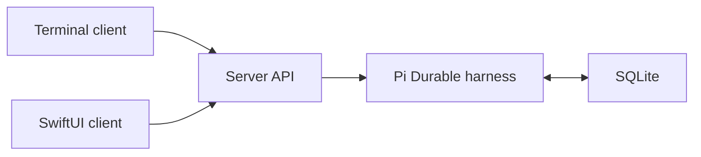

# Architecture

## Decisions

- One Git repository, with Yarn 4 workspaces for the TypeScript server and terminal client.
- Native SwiftUI iOS app built separately in Xcode.
- One server owns the Pi Durable harness and SQLite storage.
- Both clients connect to the server; clients never open the agent database or run another harness.
- Docker on the local machine is the deployment target. Cloudflare is out of scope.
- Keep agent code inside the server while it has one runtime consumer.
- Pin Pi packages together at 1.3.0. The API is experimental; check release notes before updating.

The terminal-to-server status connection exists today. Chat, streaming, background tasks, and the iOS connection are planned.

## Server boundaries

- `src/agent/`: opens the harness, registry, models, and root conversation. Add capability extensions and durable tasks here as they are implemented.
- `src/api/`: translates HTTP commands and, later, live events into the client protocol.
- `src/storage/`: opens the persistent storage backend.
- `src/config.ts`: validates environment configuration and keeps paths independent of the launch directory.

The application creates one root conversation on first startup and reopens it on subsequent startups. No model provider is registered yet. The status endpoint advertises chat and background tasks as unavailable.

## Planned behavior

The main conversation should stay available while independent jobs run in child conversations. A durable reporter should deliver completed work back to the main conversation. Closing either client should leave server work running.

Scheduled checks need persisted deadlines, a server wake-up mechanism, and an explicit overdue policy. Work cannot execute while the local machine is asleep or the server is stopped. Pi's follow-up inbox queues messages after a run; it does not by itself define recurring schedules.

Before adding external actions, define replay safety and stable operation IDs. Pi checkpoints do not make external effects exactly-once. Before exposing the server beyond localhost, add authentication.

## Storage

Local development uses the ignored `data/` directory. Docker uses a named volume mounted at `/app/data`. These are separate stores. Database files and credentials stay out of Git.
